Translated by AI([日本語](README.ja.md) | [简体中文](README.zh-Hans.md) | [繁體中文](README.zh-Hant.md))

# Arondo

Arondo is a mobile-first developer workspace that delegates coding tasks to AI agents and monitors executions across multiple machines. It follows a **Frontend + Server + Runner** architecture where lightweight Go-based Runners run on development machines and a central Server coordinates all operations.

## Basic Workflow

Arondo lets you delegate work to an AI agent from a mobile-friendly workspace, review the changes, validate them, and continue the same conversation until the task is ready to commit.

### 1. Start a session

Choose a connected Runner, project directory, and AI agent (or **Auto**), then describe your task and send it. The Agent and Model menus display remaining hourly and weekly subscription quotas directly as progress bars.

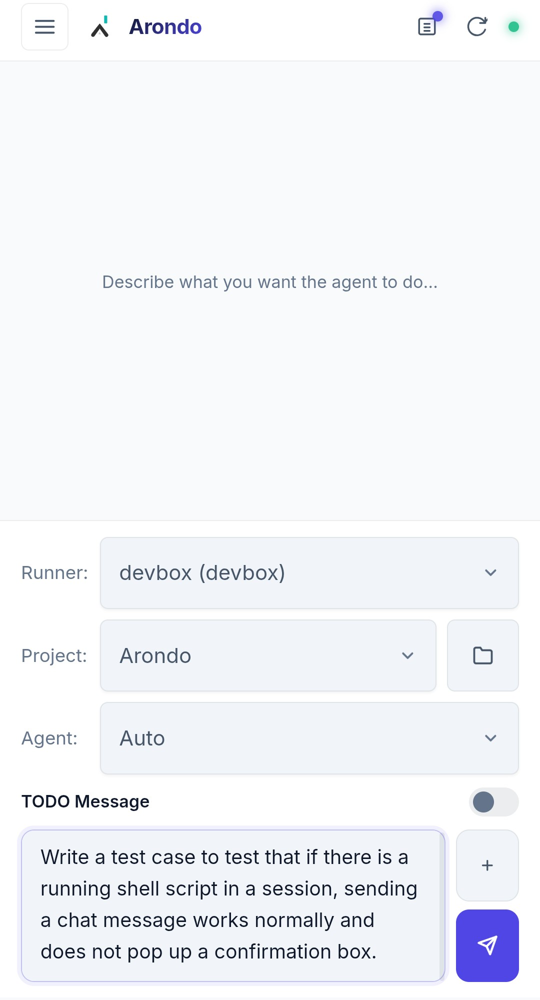

### 2. Review, validate, and commit

Review the agent's markdown response and visual Git diff, run validation scripts, send follow-up instructions when needed, and commit the completed work from the same session.

<p>
  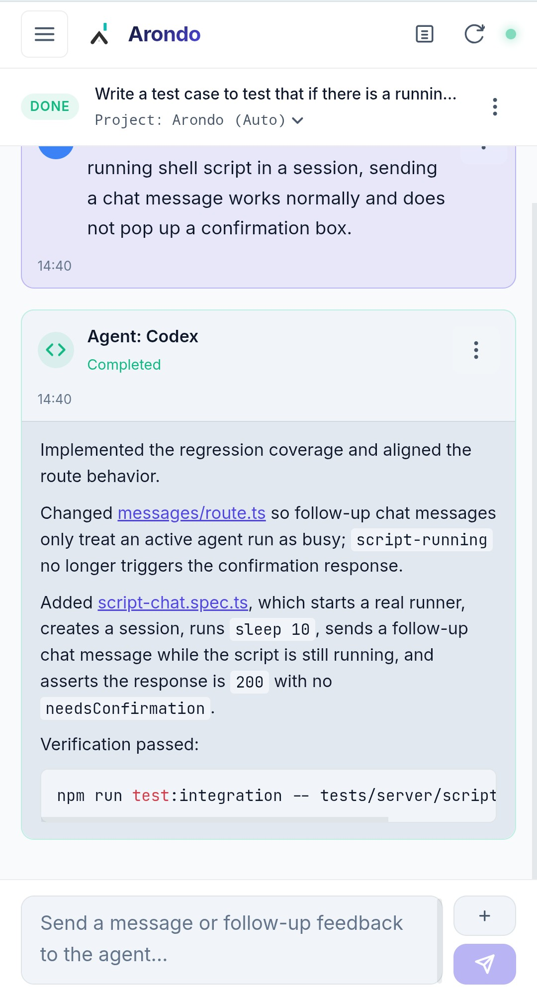
  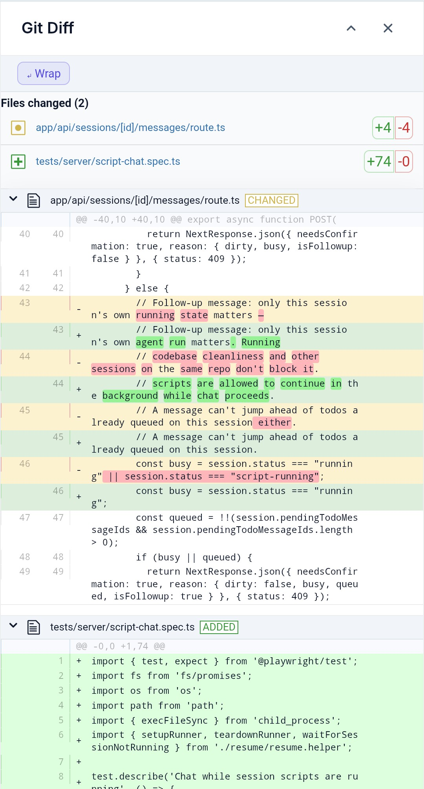
  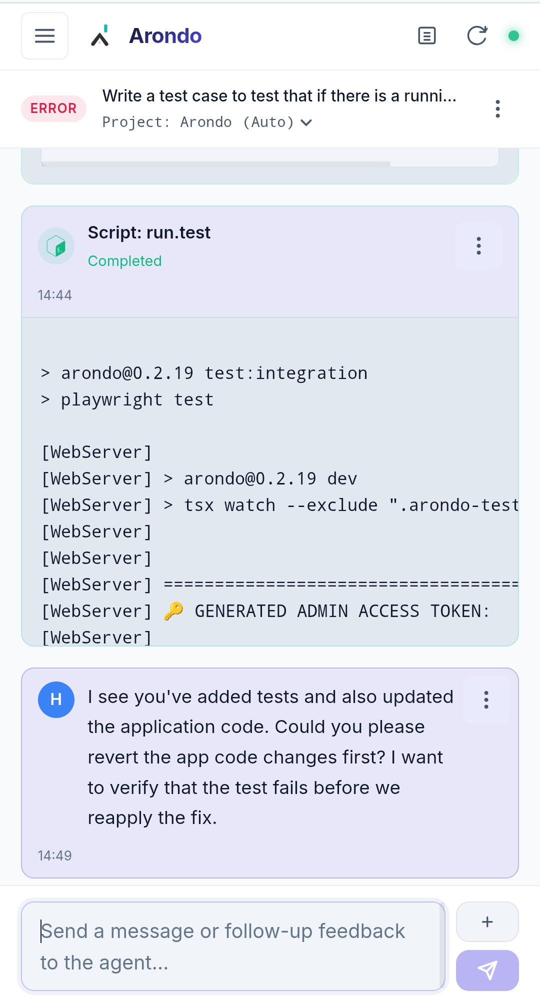
  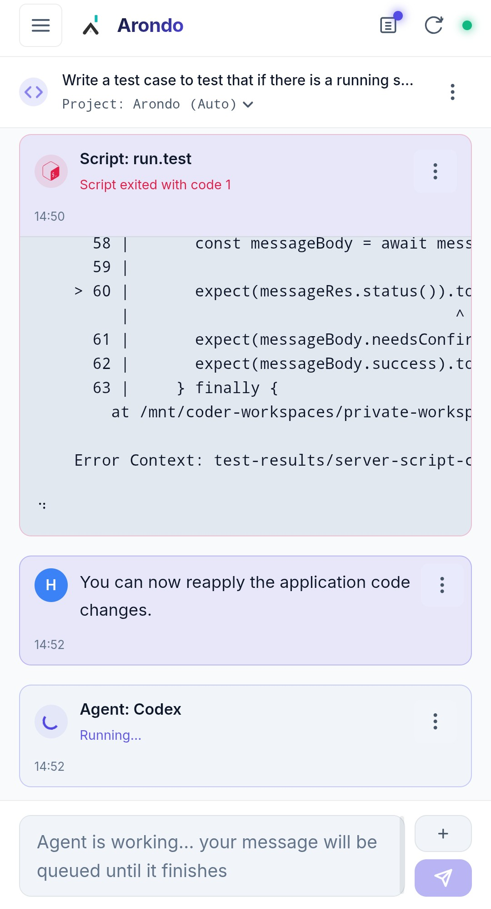
  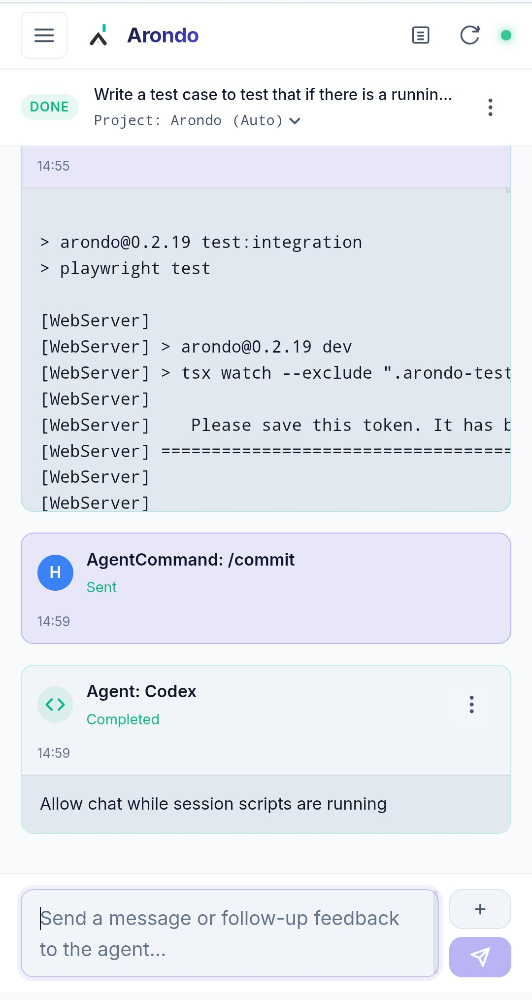
</p>

## Core Features

### Multi-Agent Support & Auto Mode

Arondo supports **Claude Code**, **Codex CLI**, **OpenCode**, **Antigravity CLI (`agy`)**, and **Pi**, with full conversation continuity (session resume) across turns.

- **Auto Mode (`autoagent`)**: Automatically selects the best installed agent on the target Runner based on live subscription quota availability—filtering out exhausted quotas, prioritizing higher remaining weekly capacity relative to reset time, and holding back API-key-billed options as a fallback.
- **Dynamic Model & Effort Routing (`automodel`)**: When enabled with TypeSafe AI Jev System One (or standard LLM API keys), automatically selects the optimal model and reasoning/thinking effort for single-use tasks, and dynamically adjusts thinking effort on every turn in ongoing sessions.
- **Quota Monitoring & Auto-Retry**: Tracks remaining quota across Runners and automatically schedules a retry when an agent hits a rate or quota limit.

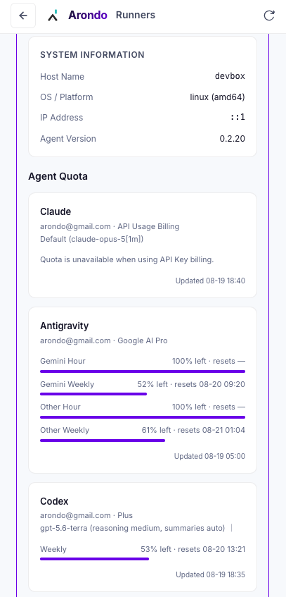

### Agent Slash Commands

Type `/` in a session or on the New Session page to run built-in or custom regex-powered slash commands configured in **Admin Settings → Default Agent Commands**:

- `/review [--agent <name>] [instructions]` — Runs a detached agent in a fresh context to review the working tree without modifying files or interrupting the main conversation.
- `/btw [--agent <name>] <message>` — Asks an independent side question using the session's conversation context without modifying files.
- `/new`, `/rename`, `/delete`, plus custom project or global commands (e.g., `/commit`).

<p>
  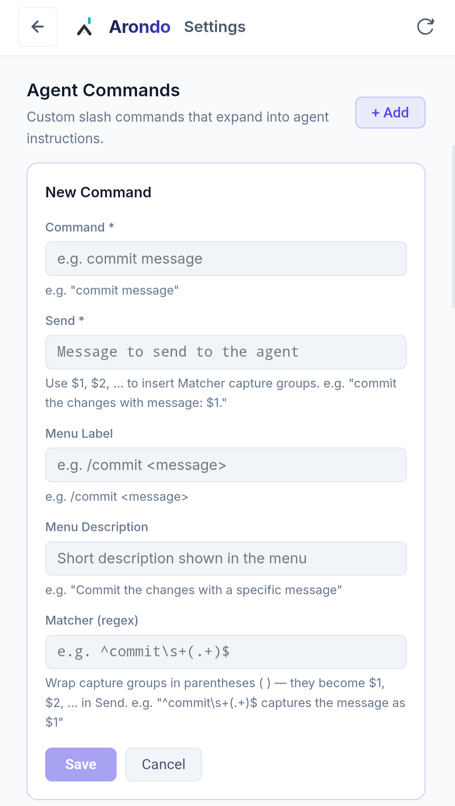
  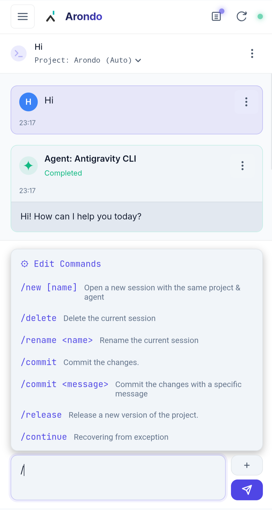
</p>

### Scripts & Fallback Terminal

- **Quick Scripts (`!`)**: Type `!` in chat or use **Run Script** on a Project Page to run shell commands and scripts concurrently in a PTY. Frequently used commands are saved per project for quick access.
- **Interactive Terminal**: Open a live `xterm.js` shell on the Runner from the session menu when manual inspection is needed, complete with a mobile special-keys bar (`ESC`, `TAB`, `CTRL`, `ALT`, arrows, `F1`–`F12`).

<p>
  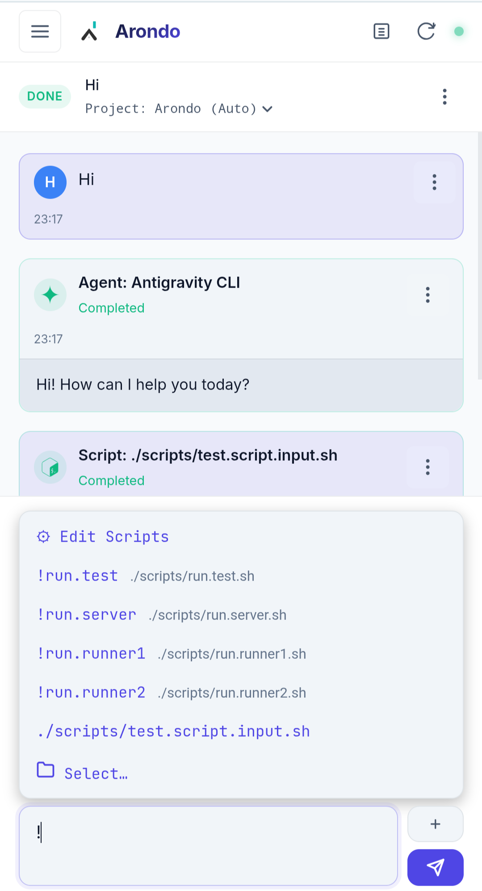
  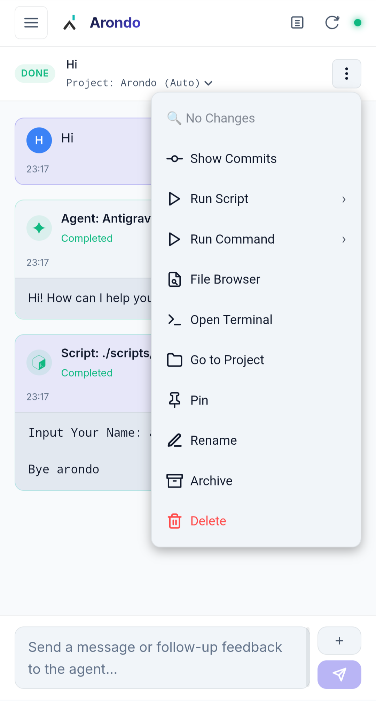
  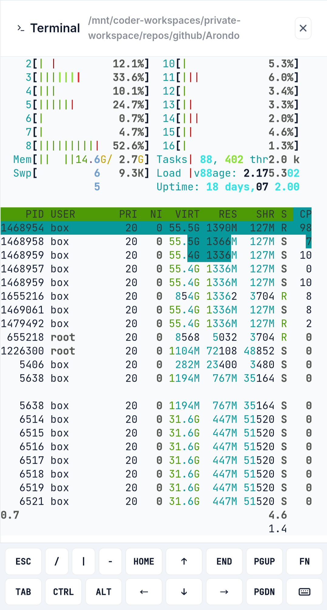
</p>

### Todo Messages & Smart Queuing

When a repository has uncommitted changes or an agent is already running, Arondo warns you and lets you queue prompts as **Todo Messages**—dispatched automatically once the codebase is clean, after the current run finishes, at a scheduled date/time, or manually.

<p>
  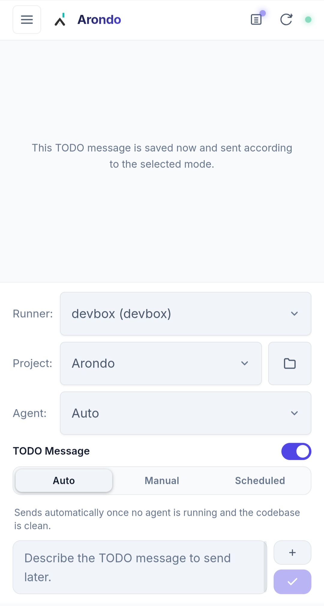
  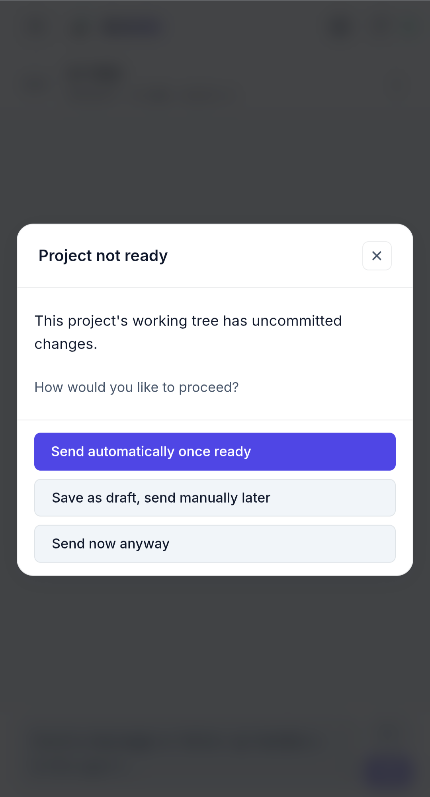
  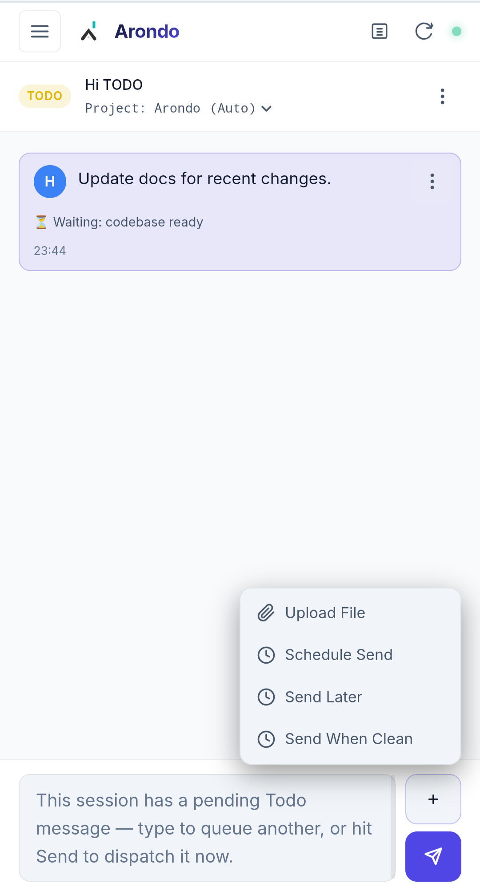
</p>

### Mobile-First Workspace & PWA

- **Installable PWA & Web Push**: Install Arondo to your home screen and receive native VAPID Web Push notifications on desktop and mobile (including iOS/iPadOS 16.4+) when agents finish, fail, or wait for terminal input.
- **Integrated File Browser & Diff Viewer**: Browse remote files with syntax highlighting, insert paths with `@`, upload files directly from chat, and inspect session or project Git diffs inline.
- **Multi-User Access Control**: Role-based authentication (`admin` and `user` tokens), dedicated per-runner tokens bound on first connect, and per-runner user access control lists.
- **Gen Main Agent (Experimental)**: A unified conversational interface (`/gen`) with self-compacting memory that automatically infers the target project and delegates multi-turn tasks to sub-agents.

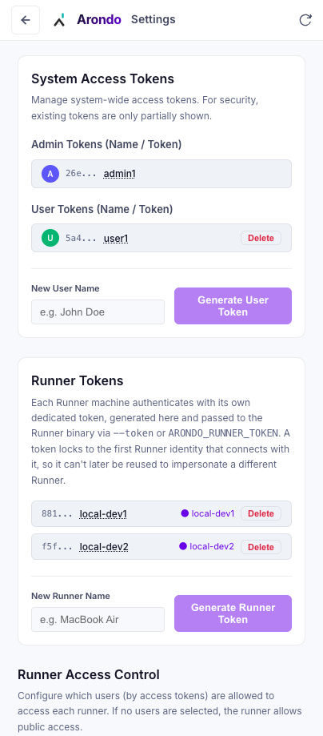

## Architecture

```
Browser (Next.js UI)  <--ws-->  Server (Next.js)  <--ws-->  Runner A (Go, machine-1)
                                                  <--ws-->  Runner B (Go, machine-2)
```

- **Runner** (`runner/`): Lightweight stateless Go binary connecting to the Server via WebSocket to execute agent CLIs, PTY scripts, file browsing, and Git operations.
- **Server**: Coordinates Runners, manages persistent state (`~/.arondo/` by default), and serves the web application and REST/WebSocket APIs.
- **Frontend**: Mobile-first React UI for sessions, projects, live terminals, diffs, and task monitoring.

## Getting Started

### 1. Install dependencies & configure environment

```bash
npm install
cp scripts/sample.env scripts/.env
```

### 2. Start the server & create a Runner token

```bash
./scripts/run.server.sh
```

Open [http://localhost:3251](http://localhost:3251) and sign in with the admin token printed in the server console on first startup. Go to **Admin Settings → Runner Tokens**, generate a token for your Runner, and set `ARONDO_RUNNER_TOKEN_LOCALDEV` in `scripts/.env`.

### 3. Start a Runner

```bash
./scripts/run.runner.sh
```

Or build and run the Go binary directly on any machine:

```bash
cd runner && bash ./build.sh
./arondo-runner --server ws://localhost:3251/runner --token <runner_token>
```

Runners support `--check-connection` to verify connectivity and `--auto-update=true` to automatically update when a newer server version is deployed.

### 4. Build the CLI (optional)

```bash
cd cli && go build -o arondo-cli . && cd ..
```

## CLI & Automation API

External scripts and coding agents can delegate tasks via the REST API (`/api/sessions`) or `cli/arondo-cli`:

```bash
# Run an isolated automation task and stream/wait for completion
cli/arondo-cli send \
  --server http://localhost:3251 \
  --client-token <client_access_token> \
  --automation \
  "Summarize the system environment"

# Continue an existing session or run a slash command on the current repo
cli/arondo-cli send --resume "/commit"

# Run fast categorical decisions via TypeSafe AI Jev System One
cli/arondo-cli decide '{"questions":{"is_urgent":{"type":"noul","instructions":"Conveys urgency"}}}'

# Inspect connected runners, available agents, and quotas
cli/arondo-cli get-agents
cli/arondo-cli get-quota
cli/arondo-cli update-quota
```

Run `cli/install-skill` to install the bundled `arondo-cli` skill for Codex, Claude Code, Antigravity CLI, or OpenCode.

## Configuration

Runtime data is stored in `ARONDO_CONFIG_DIR` (defaults to `~/.arondo/`). Most settings—including agent model defaults, LLM API keys, global agent rules, Web Push VAPID contact, and access tokens—are managed directly in the UI under **Admin Settings** (`/admin/settings`).

Common environment variables:

- `PORT` – Server port (default: `3251` in dev, `3250` in prod).
- `ARONDO_CONFIG_DIR` – Directory for configuration and session data (default: `~/.arondo`).
- `ARONDO_ENABLE_AUTOMODEL` – Enable automatic model and effort routing (`true` | `false`).
- `TYPESAFE_API_KEY`, `ANTHROPIC_API_KEY`, `OPENAI_API_KEY`, `GOOGLE_GENERATIVE_AI_API_KEY` – Optional API keys for `automodel`, Jev decisions, and LLM-assisted quota extraction.

## Testing

Run the end-to-end Playwright integration test suite (spawns an isolated server and Go runner):

```bash
npx playwright install --with-deps chromium
npm run test:integration
```
